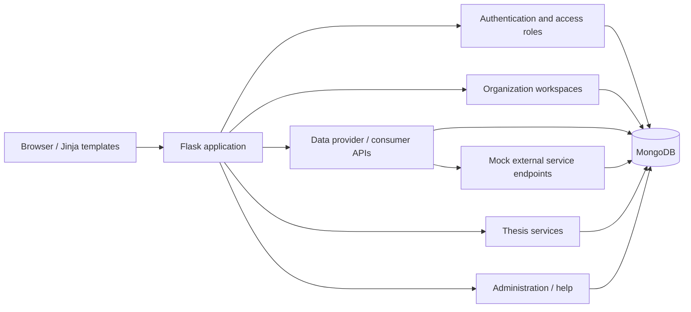

# E-DBA — Education Data Sharing Platform

**A role-based, cross-institution data-sharing web application.**

This project is a prototype of a lightweight education data space. It explores how participating higher-education institutions can register organizations, manage authorized members, and expose selected services to data consumers while maintaining role-based access boundaries.

## Highlights

- **Multi-role workflows:** administrative dashboards for technical administrators, education administrators and organization conveners, with user-level data access roles.
- **Organization onboarding:** registration and approval workflows, workspace setup, member management and service configuration.
- **Access-controlled services:** APIs and pages for course information, thesis metadata and student-record verification workflows.
- **Email-based login:** one-time verification-code flow backed by Flask-Login sessions and SMTP configuration.
- **Auditing and support:** activity records and help-request workflows for administrative review.
- **External interface simulation:** local mock endpoints for student-record, thesis and bank-related requests, allowing demonstration without live third-party systems.

> **Scope note:** Payment-related endpoints in this project are **mock/demo integrations**, not live payment processing. The presence of a route or UI does not establish production-grade authorization, payment security or completed end-to-end validation.

## Architecture



**Technology:** Python, Flask, Flask-Login, Flask-Mail, Flask-PyMongo / PyMongo, MongoDB, Jinja2 templates, HTML/CSS and JavaScript. Selected member-import flows use pandas and Excel files.

## Main modules

| Source | Responsibility |
| --- | --- |
| [`src/app/auth/`](src/app/auth/) | Login, one-time codes, authentication pages |
| [`src/app/admin/`](src/app/admin/) | Technical and education administration workflows |
| [`src/app/workspace/`](src/app/workspace/) | Organization setup, member and service management |
| [`src/app/datauser/`](src/app/datauser/) | Public/private data services, APIs, mock external interfaces |
| [`src/app/thesis/`](src/app/thesis/) | Thesis metadata, details, demo purchase/download routes |
| [`src/app/models/`](src/app/models/) | Data-access models and supporting records |
| [`src/app/templates/`](src/app/templates/) | Server-rendered UI templates |
| [`src/app/static/`](src/app/static/) | CSS, JavaScript and interface images |
| [`tests/`](tests/) | Database-backed activity-record unit tests |

The application organizes HTTP endpoints with Flask Blueprints. Some historical route definitions and template variants remain from iterative team development; this repository should be viewed as a course prototype rather than a hardened application.

## Representative interfaces

The source includes endpoints for tasks such as:

| Workflow | Example endpoint | Method |
| --- | --- | --- |
| Request login code | `/api/request_otp` | POST |
| Edit a course | `/api/datauser/course/<course_id>` | PUT |
| List courses | `/api/consumer/courses` | GET |
| Search mock thesis service | `/mock/thesis/search` | POST |
| Mock student verification | `/mock/student/authenticate` | POST |
| Mock bank transfer | `/mock/bank/transfer` | POST |

Some endpoints require a session, data records or service configuration. These are examples found in the code, **not a guaranteed fully functioning public API**.

## Local setup (development prototype)

**Prerequisites:** Python 3.10+ (the original submission contains Python 3.10/3.12 cache files), a local MongoDB instance, and optionally an SMTP test server for email codes.

1. Clone and set up the environment:

   ```bash
   git clone https://github.com/Chloe-Xia/E-DBA-Education-Data-Sharing-Platform.git
   cd E-DBA-Education-Data-Sharing-Platform
   python3 -m venv .venv
   source .venv/bin/activate
   pip install -r requirements.txt
   ```

2. Configure local environment variables (the app reads the variables directly from the process environment; `.env.example` is a reference only):

   ```bash
   export MONGO_URI="mongodb://localhost:27017/EDBA"
   export SECRET_KEY="replace-with-a-random-secret"
   export MAIL_SERVER="localhost"
   export MAIL_PORT="1025"
   ```

3. Start MongoDB separately. To test OTP emails locally, install `requirements-dev.txt` and run a local SMTP sink in another terminal:

   ```bash
   python -m pip install -r requirements-dev.txt
   python -m aiosmtpd -n -l localhost:1025
   ```

4. Launch the Flask development server:

   ```bash
   cd src
   python run.py
   ```

   The default development URL is `http://127.0.0.1:5000/`.

**Important:** The original project relied on a local MongoDB database and supporting test collections. The corresponding real database exports, uploaded documents and historical credentials are intentionally **not included**. Some workflows therefore require locally prepared **synthetic** seed data before they can be demonstrated.

### Testing

The included `tests/ActivityRecord_Test.py` uses `unittest` with a local `EDBA_TEST` MongoDB database. With MongoDB running and the project import path configured:

```bash
cd src
PYTHONPATH=. python -m unittest discover -s ../tests -p '*Test.py'
```

The test suite has **not** been executed in the packaging environment, and integration behavior is not guaranteed.

## Repository layout

```text
.
├── README.md
├── .env.example
├── .gitignore
├── requirements.txt
├── requirements-dev.txt
├── src/
│   ├── config.py
│   ├── run.py
│   └── app/
│       ├── auth/
│       ├── admin/
│       ├── workspace/
│       ├── datauser/
│       ├── thesis/
│       ├── models/
│       ├── main/
│       ├── payment/
│       ├── templates/
│       └── static/
├── tests/
└── docs/
    └── PUBLISHING_NOTES.md
```

## Known limitations and security considerations

This is an educational prototype and **must not be deployed as-is**:

- The original submission contained hardcoded configuration values; this curated snapshot replaces them with environment-driven settings. Never publish original keys or database credentials.
- Public-facing code still requires a thorough authorization and security audit. For example, some data-service handlers rely on an `X-User-Email` request header, which must not be trusted as identity without separate authentication and authorization checks.
- Mock banking, identity and document services should not be connected to real financial or student data.
- The uploaded course archive contained multiple legacy route implementations and older design-document revisions. These were excluded from this portfolio snapshot; behavioral differences from the historical submission are possible.
- The application and test suite have not been run end to end in the packaging environment; additional setup and debugging may be necessary.
- UI images are retained from the submitted project files; confirm that you are entitled to redistribute them before publication.

## Acknowledgements

Developed collaboratively as a university coursework project. The project requirements were inspired by data-space principles and inter-institutional data exchange scenarios. Confirm permission from collaborators before publishing the shared source code or assigning individual contributions.
